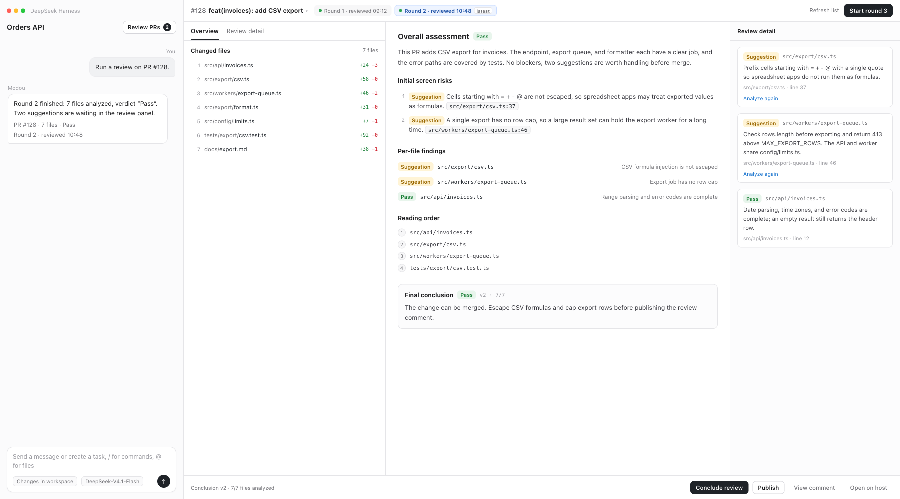
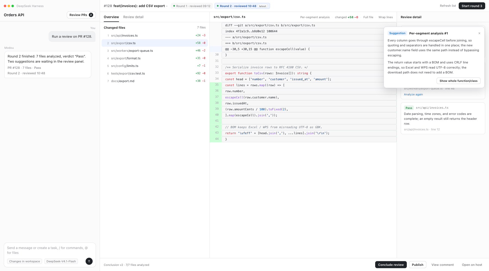

# dsh-pr-review-plugin

[English](README.md) | [简体中文](README.zh-CN.md)

AI-assisted pull request review for the DeepSeek Harness Web UI. The plugin watches a GitHub, GitLab, Gitea-compatible (Gitea / Forgejo / Codeberg), Gitee-compatible (Gitee / GitCode / AtomGit) or Alibaba Cloud Codeup repository for open pull requests, reviews new commits with the model behind your Harness session, and shows the whole review — report, per-file analysis, rounds, and final conclusion — in a panel docked next to the chat. Finished reviews are published as regular pull request comments, and follow-up discussion happens in the main conversation.





The screenshots use a fictional repository (`acme/portal`, PR #128) and contain no real project data. The panel follows the Harness UI language. The page behind them is self-contained: open [`docs/images/src/mock.html`](docs/images/src/mock.html) directly in a browser and switch `view` / `lang` in the query string.

## Features

- **Workspace aware**: each session's workspace `git origin` selects the repository and platform (GitHub; GitLab; Gitea / Forgejo / Codeberg; Gitee / GitCode / AtomGit; Codeup); the panel only shows pull requests from that repository, and switching workspaces switches reviews with it.
- **Automatic rounds**: the plugin polls for open pull requests and starts a new review round whenever new commits land (`autoReview` can be turned off).
- **Review panel**: a right-sidebar panel inside the session — changed files, diff, and per-file analysis in three resizable columns; click any hunk in the diff for its per-segment analysis, or switch to the full file (with added lines highlighted).
- **Final conclusion**: generated in the background with visible stages and cancel support; carries review coverage (X of Y files analyzed) and a version number. When the report or file analysis changes afterwards, the panel flags the outdated conclusion and offers regeneration (automatic with `autoReconclude`).
- **Version history**: every conclusion version is kept, and each review round gets its own tab, so older rounds and versions stay readable.
- **Reviewer feedback loop**: replies left by the implementer after the previous review comment are parsed into fixed / rejected / acknowledged states, marked on individual findings, and compared across rounds (resolved vs. still open).
- **Publishing**: preview the Markdown before posting, and choose which findings to include; comments are appended (never overwritten), tagged with the reviewed commit, round, conclusion version, and coverage.
- **Chat integration**: the main conversation can read and update review data through the `review_*` tools, and the panel refreshes live — ask "risk 1 doesn't hold" or "rewrite suggestion 2" and the review updates in place.

### Chat tools

Read: `review_list_prs`, `review_get`, `review_get_report`, `review_list_files`, `review_get_analysis`, `review_get_diff`, `review_get_file`, `review_list_rounds`, `review_get_round`, `review_get_comments`

Write: `review_update_analysis`, `review_update_report`, `review_update_overview`, `review_update_conclusion` (optimistic-lock guarded), plus the panel actions `review_conclude`, `review_publish`, `review_get_links`.

## Requirements

- A DeepSeek Harness (DSH) installation with the Web UI, 0.2.2-rc.1 or later in the 0.2 line (declared as `engines.dsh`; incompatible versions are rejected at install/start). The plugin runs as a Cordis function plugin and uses the Harness `llm` service for model calls (no separate API key — it uses your Harness model, or the `provider` / `model` you configure).
- The `git` CLI, so the plugin can resolve a workspace's `origin` remote.
- A supported code host. GitHub uses the REST API v3; GitLab uses REST v4; Gitea, Forgejo and Codeberg share the Gitea API (`/api/v1`); Gitee, GitCode and AtomGit share the GitHub-shaped v5 API (`/api/v5`); Codeup uses the Alibaba Cloud Yunxiao OpenAPI. Gogs exposes a different API and is **not** supported. Self-hosted Gitea instances are detected from the workspace origin.
- A code host token with permission to read pull requests and post comments (see below).

## Install

The plugin is a DSH bundle. Install it into a profile with the official CLI:

```sh
dsh plugin --profile <name> add github:modouai/dsh-pr-review-plugin
```

Point the install at a tag or commit (`…#<tag-or-sha>`) to pin what actually runs. The package is also published to npm, so `dsh plugin --profile <name> add @modouai/dsh-pr-review` works by name. To install a local checkout instead, pass its path: `dsh plugin --profile <name> add ./dsh-pr-review-plugin` (run `pnpm install` inside the checkout first — a linked checkout keeps its own `node_modules`).

Verify the layer before starting, then restart Harness:

```sh
dsh --profile <name> --dump-config   # shows a "# == @modouai/dsh-pr-review" layer
dsh --profile <name>
```

The bundle ships its default configuration in [`cordis.patch.yml`](cordis.patch.yml). See [Configuration](#configuration) for where to change values and what each key does.

## Configuration

### Where settings live

The plugin is one row in the DSH loader tree. Its defaults ship in [`cordis.patch.yml`](cordis.patch.yml) and in the plugin's `Config` schema. The loader validates values against the schema and fills missing keys before the plugin starts; a value outside the schema (for example `pollSeconds: 5` or `platform: svn`) is rejected at load.

To change settings, edit the patch layer of the profile you installed into (default location):

```text
~/.dsh/profiles/<name>/cordis.patch.yml
```

The file is a top-level YAML array. Keep one entry for this row; `dsh plugin add` writes it for you:

```yaml
- id: pr-review
  name: '@modouai/dsh-pr-review'
  config:
    platform: forgejo
    baseUrl: ''
    repo: ''
    token: ''
    organizationId: ''
    projectId: ''
    pollSeconds: 60
    autoReview: true
    autoReconclude: false
    commentLanguage: zh
    provider: ''
    model: ''
    reasoningEffort: 'off'
    maxDiffCharsPerFile: 14000
```

A patch entry replaces the row's **whole** `config` object. Omitted keys fall back to the schema defaults (the values above), not to a merge with the bundle row. Start from the full block and change only what you need.

Restart Harness after editing: the host half (`index.js`, `providers.js`, `llm.js`) does not hot-reload. Check the merged layer before starting:

```sh
dsh --profile <name> --dump-config
```

### Repository selection

Repository selection is workspace-first:

- When the session workspace is a git repository with an `origin` remote, that remote selects the repository and platform. `github.com` selects GitHub, `gitlab.com` GitLab, `gitee.com` Gitee, `gitcode.com` / `gitcode.net` GitCode, `atomgit.com` AtomGit, `codeup.aliyun.com` Codeup; other hosts fall back to the Gitea API.
- Switching workspaces switches the active repository, its pull request list, and its cache.
- `platform`, `baseUrl`, and `repo` are fallback values. The plugin uses them before a workspace origin is recognized (for example, during startup polling or in a non-git workspace). Once a workspace resolves an origin, the origin wins.

Use the fallback when the workspace is not a git repository, or when you want polling to start on a known repository before any workspace is attached.

### Connection settings

| Key | Accepted values | Default | Effect |
|---|---|---|---|
| `platform` | `github`, `gitea`, `forgejo`, `gitlab`, `gitee`, `gitcode`, `atomgit`, `codeup` | `forgejo` | API family for the fallback repository. `gitea` and `forgejo` are aliases for the same Gitea API; `gitee`, `gitcode` and `atomgit` share one adapter. |
| `baseUrl` | URL, or empty | empty | Fallback host. Gitea/Forgejo: site root without `/api/v1`. GitLab: instance root without `/api/v4` (default `https://gitlab.com`). Gitee: API root (default `https://gitee.com/api/v5`). GitCode: `https://api.gitcode.com/api/v5`. AtomGit: `https://api.atomgit.com/api/v5`. Codeup: API domain (default `https://openapi-rdc.aliyuncs.com`; a Region-edition organization uses its own `*.devops.aliyuncs.com` domain). Empty means "derive from the workspace origin". |
| `repo` | `owner/name`, or empty | empty | Fallback repository. GitLab subgroups (`group/subgroup/project`) are supported. Empty means "derive from the workspace origin". |
| `organizationId` | string, or empty | empty | Codeup only. Empty reads the first segment of the workspace origin. |
| `projectId` | string, or empty | empty | Codeup only. Numeric project id. Empty resolves it from `organizationId` + repository path through the Codeup API. |
| `token` | token string, or empty | empty | Explicit API token. Empty falls back to environment variables; GitHub and Gitea/Forgejo also try their CLI login (see below). |

### Review behavior

| Key | Accepted values | Default | Effect |
|---|---|---|---|
| `pollSeconds` | number ≥ 15 | `60` | How often the plugin polls for open pull requests. It also bounds how quickly new commits are noticed; the minimum is 15 seconds. |
| `autoReview` | boolean | `true` | Start a round automatically when a pull request first appears or its head SHA changes. Set `false` to review only when you click **Review now**. A failed round is retried after 5 minutes. |
| `autoReconclude` | boolean | `false` | Regenerate the conclusion when the report or per-file analysis changes after it. Runs at most once every 5 minutes, never during a running round, and only while the conclusion is stale. |
| `commentLanguage` | `zh`, `en` | `zh` | Language of the published comment's labels, headings, appendix, and footer. It does not translate model-written summaries or findings; the built-in prompts are Chinese. |

### Model and limits

| Key | Accepted values | Default | Effect |
|---|---|---|---|
| `provider` / `model` | strings, or empty | empty | Both must be set to take effect. Otherwise the plugin uses the current Harness default model. Setting only one falls back to the default. |
| `reasoningEffort` | `off`, `low`, `high`, `max` | `off` | Reasoning effort for report, per-file, and conclusion calls. If the selected model rejects the level, the plugin retries the call without it. |
| `maxDiffCharsPerFile` | number ≥ 1000 | `14000` | Maximum diff characters per file sent to the model. The report call uses at most 2,200 characters per file and 120,000 characters of excerpts in total. |

### Token resolution

The first non-empty value wins:

| Platform | Resolution order |
|---|---|
| `github` | `config.token` → `GITHUB_TOKEN` → `GH_TOKEN` → `gh auth login` |
| `gitea` / `forgejo` | `config.token` → `GITEA_TOKEN` → `FORGEJO_TOKEN` → `PR_REVIEW_TOKEN` → `tea` login |
| `gitlab` | `config.token` → `GITLAB_TOKEN` → `PR_REVIEW_TOKEN` |
| `gitee` | `config.token` → `GITEE_TOKEN` → `PR_REVIEW_TOKEN` |
| `gitcode` | `config.token` → `GITCODE_TOKEN` → `GITEE_TOKEN` → `PR_REVIEW_TOKEN` |
| `atomgit` | `config.token` → `ATOMGIT_TOKEN` → `GITEE_TOKEN` → `PR_REVIEW_TOKEN` |
| `codeup` | `config.token` → `CODEUP_TOKEN` → `YUNXIAO_TOKEN` → `PR_REVIEW_TOKEN` |

The token needs permission to read pull requests and post comments. For private repositories it needs repository read access.

The CLI fallback applies to GitHub (`gh`) and Gitea/Forgejo (`tea`) only. GitLab, Gitee, GitCode, AtomGit and Codeup read the token from `config.token` or their environment variable.

Prefer an environment variable or CLI login over storing the token in `cordis.patch.yml`: the file is plaintext. The plugin never writes the token to the review cache.

### Example setups

**Follow the workspace (default).** Leave the repository keys empty and provide the token through the environment:

```sh
export GITEA_TOKEN=...     # Gitea / Forgejo
export GITHUB_TOKEN=...    # GitHub
export GITLAB_TOKEN=...    # GitLab
export GITEE_TOKEN=...     # Gitee, and the fallback for GitCode / AtomGit
export GITCODE_TOKEN=...   # GitCode (optional override)
export ATOMGIT_TOKEN=...   # AtomGit (optional override)
export CODEUP_TOKEN=...    # Codeup (YUNXIAO_TOKEN works too)
```

**Start on a fixed Gitea/Forgejo repository.** Use this for a non-git workspace, or to poll before a workspace is attached:

```yaml
- id: pr-review
  name: '@modouai/dsh-pr-review'
  config:
    platform: forgejo
    baseUrl: https://git.example.com
    repo: acme/portal
    token: ''
    pollSeconds: 60
    autoReview: true
    autoReconclude: false
    commentLanguage: zh
    provider: ''
    model: ''
    reasoningEffort: 'off'
    maxDiffCharsPerFile: 14000
```

**Start on a fixed GitHub repository.** Use `platform: github` and the GitHub API root:

```yaml
- id: pr-review
  name: '@modouai/dsh-pr-review'
  config:
    platform: github
    baseUrl: https://api.github.com
    repo: acme/portal
    token: ''
    pollSeconds: 60
    autoReview: true
    autoReconclude: false
    commentLanguage: en
    provider: ''
    model: ''
    reasoningEffort: 'off'
    maxDiffCharsPerFile: 14000
```

**Start on a fixed Codeup repository.** Codeup needs the organization id and the repository path; both default from the workspace origin. `projectId` is optional (it is resolved through the Codeup API when empty):

```yaml
- id: pr-review
  name: '@modouai/dsh-pr-review'
  config:
    platform: codeup
    baseUrl: https://openapi-rdc.aliyuncs.com
    repo: <organizationId>/<group>/<repo>
    organizationId: ''
    projectId: ''
    token: ''
    pollSeconds: 60
    autoReview: true
    autoReconclude: false
    commentLanguage: zh
    provider: ''
    model: ''
    reasoningEffort: 'off'
    maxDiffCharsPerFile: 14000
```

**Start on a fixed GitLab or Gitee-family repository.** Use `platform: gitlab` with the instance root, or `platform: gitee` / `gitcode` / `atomgit` with the matching API root; `repo` stays `owner/name` (GitLab also accepts `group/subgroup/project`).

**Keep cost and latency down.** Poll less often, review only on demand, and send less diff text. These keys go inside the row's `config:` block:

```yaml
    pollSeconds: 180
    autoReview: false
    reasoningEffort: 'off'
    maxDiffCharsPerFile: 8000
```

**Favor thorough reviews.** Spend more reasoning on the report and the conclusion, and keep the conclusion in sync automatically:

```yaml
    reasoningEffort: high
    autoReconclude: true
    maxDiffCharsPerFile: 24000
```

The last two snippets are partial on purpose: unlisted keys keep their defaults. If you are editing the full row, merge these keys into the full block instead.

## Usage

1. In a session, click the **Review PRs** button in the session header (or the card under the composer in an empty session).
2. Pick a pull request at the top; with `autoReview` on, the first review starts in the background (otherwise click **Review now**).
3. Click a file in the left column to read its diff and analysis; click a hunk for the per-segment walkthrough; switch to the full file when needed.
4. Discuss in the main conversation — for example "risk 1 doesn't hold" or "turn suggestion 2 into a blocker" — and the review data updates directly.
5. Click **Conclude review**; if the report changes afterwards, the panel offers **Regenerate conclusion**.
6. Click **Publish** to preview the Markdown, select the findings to include, and append the comment. Each round appends a new comment; history is never overwritten.
7. Use the round tabs at the top to revisit earlier rounds and conclusion versions (read-only).
8. After the implementer replies under the previous review comment, click **Check developer feedback** (the panel also checks automatically every 2 minutes) to see per-finding states and the resolved-vs-still-open comparison. New commits start the next round.

## Data

Review results are cached per repository under `~/.dsh/pr-review/<platform>-<repo>.json` (`gitea` uses the `forgejo` slug, so both names read the same cache). All conclusion versions and round history live in that cache and survive restarts; diffs and file contents are re-fetched on demand.

## Notes

- Upgrading the plugin: the browser side (`client.js`) hot-reloads; the host side (`index.js` / `providers.js` / `llm.js`) requires restarting Harness.
- The pull request list shows the 20 most recently updated open pull requests; the panel says so when older ones exist.
- Cache writes are atomic (temp file + rename). If the cache cannot be read, the plugin moves it aside as `<name>.corrupt-<timestamp>` instead of overwriting it, and shows a warning in the panel.
- Published comments carry a footer identifying the plugin; the language follows `commentLanguage`.
- Comments are truncated gracefully if they exceed the platform's 60,000-character limit: the appendix shrinks first, then entries are omitted, and the truncation points to the review panel for details.

## License

[MIT](LICENSE)
