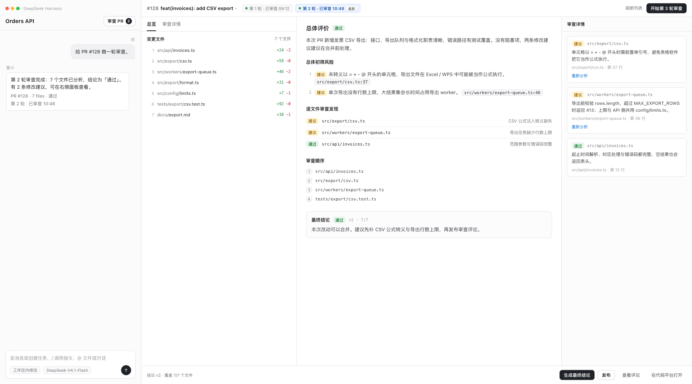
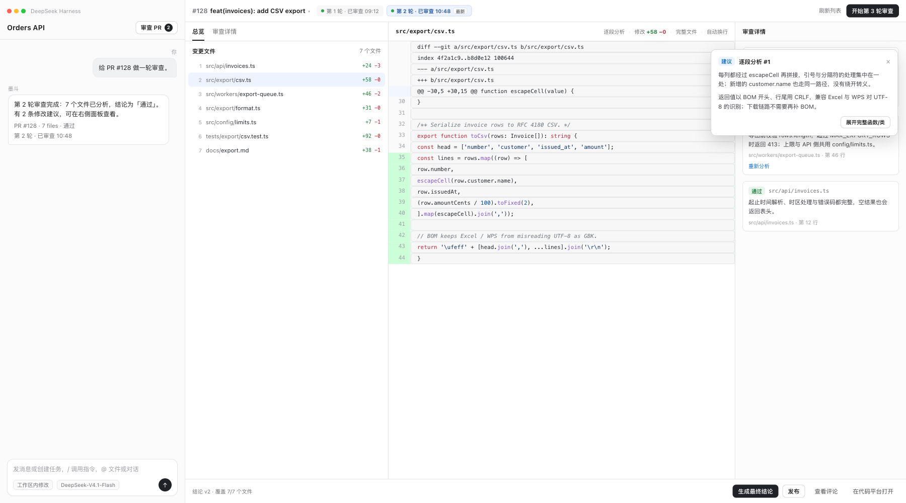

# dsh-pr-review-plugin

[English](README.md) | [简体中文](README.zh-CN.md)

面向 DeepSeek Harness Web UI 的 AI 拉取请求审查插件。插件监视 GitHub、GitLab、Gitea 系（Gitea / Forgejo / Codeberg）、Gitee 系（Gitee / GitCode / AtomGit）或阿里云 Codeup 仓库的 open PR，用当前 Harness 会话背后的模型审查新提交，并在主对话旁边的面板里呈现完整审查结果：报告、逐文件分析、多轮审查与最终结论。审查结论以普通 PR 评论发布，后续讨论在主对话里进行。





示例图使用虚构仓库（`acme/portal`，PR #128），不含任何真实项目数据。面板语言跟随 Harness 界面语言。示例页本身是自包含的：用浏览器直接打开 [`docs/images/src/mock.html`](docs/images/src/mock.html)，在查询串里切换 `view` / `lang`。

## 功能

- **按工作区识别仓库**：每个会话工作区的 git `origin` 决定仓库与平台（GitHub；GitLab；Gitea / Forgejo / Codeberg；Gitee / GitCode / AtomGit；Codeup）；面板只显示该仓库的 PR，切换工作区即切换对应的审查数据。
- **自动轮次**：插件后台轮询 open PR，出现新提交（head sha 变化）即自动开始新一轮审查（可用 `autoReview` 关闭）。
- **审查面板**：会话内右侧边栏面板——变更文件、diff、逐文件分析三列布局，列宽可拖动；点击 diff 中的 hunk 查看逐段分析，也可切换到完整文件视图（新增行高亮）。
- **最终结论**：后台生成，展示阶段进度、可随时取消；结论带审查覆盖率（已分析 X/Y 文件）与版本号。报告或文件分析在结论之后又更新时，面板提示结论已过期并可重新生成（`autoReconclude` 可改为自动）。
- **版本历史**：每个结论版本都保留，每轮审查有独立页签，历史轮次与旧版本随时可回看（只读）。
- **实现者反馈闭环**：自动读取实现者在上一轮审查评论后的回复，解析为「已修复 / 不认可 / 已认可 / 有疑问」并标注到对应意见上，跨轮对比「已修复 / 仍未解决」。
- **发布**：发布前预览 Markdown 并勾选要纳入的条目；评论只追加、不覆盖，并标注被审 commit、轮次、结论版本与覆盖率。
- **对话集成**：主对话通过 `review_*` 工具读取和修改审查数据，面板实时刷新——说「第 1 条风险不成立」「把第 2 条建议改成阻塞项」，审查数据直接更新。

### 对话工具

读取：`review_list_prs`、`review_get`、`review_get_report`、`review_list_files`、`review_get_analysis`、`review_get_diff`、`review_get_file`、`review_list_rounds`、`review_get_round`、`review_get_comments`

写入：`review_update_analysis`、`review_update_report`、`review_update_overview`、`review_update_conclusion`（乐观锁保护），以及对应面板动作的 `review_conclude`、`review_publish`、`review_get_links`。

## 环境要求

- 已安装 DeepSeek Harness（DSH）Web UI，版本 0.2.2-rc.1 起、0.2 线内（见 `engines.dsh`；不满足时安装/启动会拒绝）。插件以 Cordis function-plugin 形式运行，模型调用走 Harness 的 `llm` 服务（无需单独 API key，默认用 Harness 当前模型，也可通过 `provider` / `model` 指定）。
- 本机装有 `git` 命令行，用于解析工作区的 `origin` remote。
- 受支持的代码平台（见[支持的代码平台](#支持的代码平台)）。Gogs、Bitbucket、SVN **不支持**。
- 代码平台的 token，需有读取 PR 与发布评论的权限。

## 支持的代码平台

插件按工作区连接一个代码平台。工作区的 `git origin` 决定用哪个平台；`platform` / `baseUrl` / `repo` 设置插件的默认目标（见[仓库如何选择](#仓库如何选择)）。

| 平台 | `platform` | origin 主机 | `baseUrl` 为空时 | 仓库格式 | token 来源 | CLI 登录 |
|---|---|---|---|---|---|---|
| GitHub | `github` | `github.com` | `https://api.github.com` | `owner/name` | `token`、`GITHUB_TOKEN`、`GH_TOKEN` | `gh` |
| GitLab | `gitlab` | `gitlab.com` | `https://gitlab.com`（适配器补 `/api/v4`） | `group/subgroup/project` | `token`、`GITLAB_TOKEN`、`PR_REVIEW_TOKEN` | — |
| Gitea / Forgejo / Codeberg | `forgejo`（别名 `gitea`） | 自建 Gitea / Forgejo 主机、`codeberg.org` | 站点根，不带 `/api/v1`（适配器补上） | `owner/name` | `token`、`GITEA_TOKEN`、`FORGEJO_TOKEN`、`PR_REVIEW_TOKEN` | `tea` |
| Gitee | `gitee` | `gitee.com` | `https://gitee.com/api/v5`（也接受站点根） | `owner/name` | `token`、`GITEE_TOKEN`、`PR_REVIEW_TOKEN` | — |
| GitCode | `gitcode` | `gitcode.com`、`gitcode.net` | `https://api.gitcode.com/api/v5`（也接受站点根） | `owner/name` | `token`、`GITCODE_TOKEN`、`GITEE_TOKEN`、`PR_REVIEW_TOKEN` | — |
| AtomGit | `atomgit` | `atomgit.com` | `https://api.atomgit.com/api/v5`（也接受站点根） | `owner/name` | `token`、`ATOMGIT_TOKEN`、`GITEE_TOKEN`、`PR_REVIEW_TOKEN` | — |
| Codeup | `codeup` | `codeup.aliyun.com` | `https://openapi-rdc.aliyuncs.com` | `org/group/repo` | `token`、`CODEUP_TOKEN`、`YUNXIAO_TOKEN`、`PR_REVIEW_TOKEN` | — |

- `baseUrl` 字段本身默认空；表里写的是留空时适配器使用的值（Gitea / Forgejo 取工作区 origin）。
- `gitea` 与 `forgejo` 是同一套 Gitea API 的别名，共用一份缓存。
- GitCode 与 AtomGit 接受 `GITEE_TOKEN`，因为三者共用 Gitee v5 API。
- `tea` 登录适用于任意 Gitea 兼容主机，包括 Codeberg。
- Codeup 还需要 `organizationId`（留空取 `repo` 首段）和可选的 `projectId`（留空时调 API 解析）。
- 自建 Gitea / Forgejo 主机由 origin 识别。未识别主机会回退到 Gitea 适配器，包括自建 GitLab 与 GitHub Enterprise。
- token 需有读取 PR 与发布评论的权限；私有仓库还需仓库读权限。

## 安装

本插件是一个 DSH 组合包，用官方 CLI 安装进 profile：

```sh
dsh plugin --profile <name> add github:modouai/dsh-pr-review-plugin
```

需要锁定实际运行的代码时，在地址后加 tag 或 commit（`…#<tag-or-sha>`）。包已发布到 npm，也可以按包名安装：`dsh plugin --profile <name> add @modouai/dsh-pr-review`。安装本地 checkout 则传路径：`dsh plugin --profile <name> add ./dsh-pr-review-plugin`（先在 checkout 里执行 `pnpm install`，链接安装保留各自独立的 `node_modules`）。

启动 Harness 之前，先为你的平台准备 token：环境变量、配置里的 `token`，或 GitHub / Gitea 的 CLI 登录（见[支持的代码平台](#支持的代码平台)）。工作区是 git 仓库时不需要填仓库；origin 会决定仓库与平台。

验证层，再启动 Harness：

```sh
dsh --profile <name> --dump-config   # 应出现 "# == @modouai/dsh-pr-review" 层
dsh --profile <name>
```

启动后 host 会打印 `[pr-review] ready: …`，带当前平台与 API 地址。包自带默认配置（[`cordis.patch.yml`](cordis.patch.yml)）；默认目标与其余键见[配置](#配置)。

## 配置

### 配置文件在哪

插件是 DSH 加载器树里的一行。默认配置由包内 [`cordis.patch.yml`](cordis.patch.yml) 提供，同时声明在插件的 `Config` schema 里。加载器按 schema 校验取值、补齐缺省字段后才启动插件；超出 schema 的取值（例如 `pollSeconds: 5`、`platform: svn`）会在加载时被拒绝。

改配置时，编辑所装 profile 的 patch 层（默认位置）：

```text
~/.dsh/profiles/<name>/cordis.patch.yml
```

文件顶层是 YAML 数组。保留这一行（`dsh plugin add` 会写入）：

```yaml
- id: pr-review
  name: '@modouai/dsh-pr-review'
  config:
    platform: forgejo
    baseUrl: ''
    repo: ''
    token: ''
    organizationId: ''
    projectId: ''
    pollSeconds: 60
    autoReview: true
    autoReconclude: false
    commentLanguage: zh
    provider: ''
    model: ''
    reasoningEffort: 'off'
    maxDiffCharsPerFile: 14000
```

patch 会**整体替换**该行的 `config`。没写的键回落到 schema 默认值（即上面的取值），不会与包内行合并。改的时候从完整块复制，只动需要的键。

改完重启 Harness：host 侧（`index.js`、`providers.js`、`llm.js`）不热加载。启动前检查合并结果：

```sh
dsh --profile <name> --dump-config
```

### 仓库如何选择

仓库选择以工作区为准：

- 会话工作区是配置了 `origin` 的 git 仓库时，由该 remote 决定仓库与平台。主机映射见[支持的代码平台](#支持的代码平台)；未识别主机回退到 Gitea API。
- 切换工作区即切换当前仓库、PR 列表与缓存。
- `platform`、`baseUrl`、`repo` 只在工作区解析出仓库之前使用：显式填写时，host 在后台轮询该目标。工作区挂上后，以它的 origin 为准，面板跟随工作区。

工作区不是 git 仓库时不会激活任何仓库：面板显示工作区错误，不会回退到默认目标。自建 GitLab 与 GitHub Enterprise 的 origin 不会被识别为对应平台，见[支持的代码平台](#支持的代码平台)。

### 连接配置

| 字段 | 取值 | 默认 | 作用 |
|---|---|---|---|
| `platform` | `github`、`gitea`、`forgejo`、`gitlab`、`gitee`、`gitcode`、`atomgit`、`codeup` | `forgejo` | 默认目标使用的 API 家族。`gitea` 与 `forgejo` 是同一套 Gitea API 的别名；`gitee`、`gitcode`、`atomgit` 共用一个适配器。 |
| `baseUrl` | URL 或空 | 空 | 默认目标主机。留空时使用[支持的代码平台](#支持的代码平台)里的平台默认值；Gitea / Forgejo 的默认值即工作区 origin。 |
| `repo` | `owner/name` 或空 | 空 | 默认目标仓库。GitLab 支持子组（`group/subgroup/project`）；Codeup 用 `org/group/repo`。留空表示按工作区 origin 识别。 |
| `organizationId` | 字符串或空 | 空 | 仅 Codeup：组织 ID。留空取 `repo` 首段（工作区提供时即 origin 路径）。 |
| `projectId` | 字符串或空 | 空 | 仅 Codeup：数值项目 ID。留空时用组织 ID + 仓库路径调 Codeup API 解析。 |
| `token` | token 字符串或空 | 空 | 显式 token。留空回退环境变量；GitHub 与 Gitea / Forgejo 还会尝试 CLI 登录（见下）。 |

### 审查行为

| 字段 | 取值 | 默认 | 作用 |
|---|---|---|---|
| `pollSeconds` | 数字，≥ 15 | `60` | 轮询 open PR 的间隔，也决定新提交多久被发现；最小 15 秒。 |
| `autoReview` | 布尔 | `true` | PR 首次出现或 head sha 变化时自动开启一轮审查。设为 `false` 后只在点「立即审查」时审查。失败的轮次 5 分钟后重试。 |
| `autoReconclude` | 布尔 | `false` | 报告或逐文件分析在结论之后更新时自动重新生成结论。5 分钟内最多一次，审查进行中不触发，结论未过期不触发。 |
| `commentLanguage` | `zh`、`en` | `zh` | 发布评论里的固定标签、标题、附录与署名行用哪种语言。模型写的摘要与意见不翻译；内置提示词是中文。 |

### 模型与上限

| 字段 | 取值 | 默认 | 作用 |
|---|---|---|---|
| `provider` / `model` | 字符串或空 | 空 | 两个都填才生效；否则用 Harness 当前默认模型。只填一个也回落到默认模型。 |
| `reasoningEffort` | `off`、`low`、`high`、`max` | `off` | 报告、逐文件分析与结论调用的思考档位。模型不支持该档位时，插件去掉档位重试。 |
| `maxDiffCharsPerFile` | 数字，≥ 1000 | `14000` | 单个文件送入模型的最大 diff 字符数。报告调用每文件最多用 2,200 字符，摘录合计最多 120,000 字符。 |

### token 读取顺序

第一个非空值生效：

| 平台 | 读取顺序 |
|---|---|
| `github` | `config.token` → `GITHUB_TOKEN` → `GH_TOKEN` → `gh auth login` |
| `gitea` / `forgejo` | `config.token` → `GITEA_TOKEN` → `FORGEJO_TOKEN` → `PR_REVIEW_TOKEN` → `tea` 登录 |
| `gitlab` | `config.token` → `GITLAB_TOKEN` → `PR_REVIEW_TOKEN` |
| `gitee` | `config.token` → `GITEE_TOKEN` → `PR_REVIEW_TOKEN` |
| `gitcode` | `config.token` → `GITCODE_TOKEN` → `GITEE_TOKEN` → `PR_REVIEW_TOKEN` |
| `atomgit` | `config.token` → `ATOMGIT_TOKEN` → `GITEE_TOKEN` → `PR_REVIEW_TOKEN` |
| `codeup` | `config.token` → `CODEUP_TOKEN` → `YUNXIAO_TOKEN` → `PR_REVIEW_TOKEN` |

token 需有读取 PR 与发布评论的权限；私有仓库还需仓库读权限。

CLI 登录只覆盖 GitHub（`gh`）与 Gitea / Forgejo（`tea`）；GitLab、Gitee、GitCode、AtomGit、Codeup 只从 `config.token` 或对应环境变量读取。

优先用环境变量或 CLI 登录，不要把 token 写进 `cordis.patch.yml`：该文件是明文。插件不会把 token 写进审查缓存。

### 配置示例

**跟随工作区（默认）**：仓库键留空，token 走环境变量：

```sh
export GITEA_TOKEN=...     # Gitea / Forgejo
export GITHUB_TOKEN=...    # GitHub
export GITLAB_TOKEN=...    # GitLab
export GITEE_TOKEN=...     # Gitee；也是 GitCode / AtomGit 的回退
export GITCODE_TOKEN=...   # GitCode（可选覆盖）
export ATOMGIT_TOKEN=...   # AtomGit（可选覆盖）
export CODEUP_TOKEN=...    # Codeup（也认 YUNXIAO_TOKEN）
```

**固定 Gitea / Forgejo 仓库**：用于在工作区挂上之前先轮询；git 工作区仍会把面板切到自己的 origin：

```yaml
- id: pr-review
  name: '@modouai/dsh-pr-review'
  config:
    platform: forgejo
    baseUrl: https://git.example.com
    repo: acme/portal
    token: ''
    pollSeconds: 60
    autoReview: true
    autoReconclude: false
    commentLanguage: zh
    provider: ''
    model: ''
    reasoningEffort: 'off'
    maxDiffCharsPerFile: 14000
```

**固定 GitHub 仓库**：`platform` 用 `github`，`baseUrl` 填 GitHub API 根：

```yaml
- id: pr-review
  name: '@modouai/dsh-pr-review'
  config:
    platform: github
    baseUrl: https://api.github.com
    repo: acme/portal
    token: ''
    pollSeconds: 60
    autoReview: true
    autoReconclude: false
    commentLanguage: en
    provider: ''
    model: ''
    reasoningEffort: 'off'
    maxDiffCharsPerFile: 14000
```

**固定 GitLab 仓库**：`baseUrl` 填实例根，子组写进 `repo`：

```yaml
- id: pr-review
  name: '@modouai/dsh-pr-review'
  config:
    platform: gitlab
    baseUrl: https://gitlab.com
    repo: group/subgroup/project
    token: ''
    pollSeconds: 60
    autoReview: true
    autoReconclude: false
    commentLanguage: en
    provider: ''
    model: ''
    reasoningEffort: 'off'
    maxDiffCharsPerFile: 14000
```

该示例面向 `gitlab.com`；自建 GitLab 的 origin 不会被识别，会回退到 Gitea 适配器。

**固定 Codeup 仓库**：`repo` 用 `org/group/repo`；`organizationId` 留空取首段，`projectId` 留空时由 Codeup API 解析：

```yaml
- id: pr-review
  name: '@modouai/dsh-pr-review'
  config:
    platform: codeup
    baseUrl: https://openapi-rdc.aliyuncs.com
    repo: <organizationId>/<group>/<repo>
    organizationId: ''
    projectId: ''
    token: ''
    pollSeconds: 60
    autoReview: true
    autoReconclude: false
    commentLanguage: zh
    provider: ''
    model: ''
    reasoningEffort: 'off'
    maxDiffCharsPerFile: 14000
```

`repo` 用 `org/group/repo` 形式时，`organizationId` 显式填写会覆盖首段；其余部分作为仓库路径。

**固定 Gitee 系仓库**：`platform` 用 `gitee`、`gitcode` 或 `atomgit`；`baseUrl` 填站点根或对应 API 根；`repo` 仍是 `owner/name`。

**降低开销与等待**：少轮询、只在手动点「立即审查」时审查、少送 diff。以下键放进该行的 `config:`：

```yaml
    pollSeconds: 180
    autoReview: false
    reasoningEffort: 'off'
    maxDiffCharsPerFile: 8000
```

**更充分的审查**：给报告与结论更多思考预算，并让结论自动跟上：

```yaml
    reasoningEffort: high
    autoReconclude: true
    maxDiffCharsPerFile: 24000
```

后两段是局部片段：没写的键保持默认值。编辑完整行时，把这些键并进完整块。

## 使用

1. 在会话里点头部的「审查 PR」按钮（空会话点输入框下方的「审查 PR」卡片）。
2. 顶部选择 PR；`autoReview` 开启时首轮审查在后台自动开始，关闭时点「立即审查」。
3. 左栏点文件查看 diff 与分析；点 hunk 看逐段讲解；需要时切换完整文件视图。
4. 在主对话里继续讨论——例如「第 1 条风险不成立」「把第 2 条建议改成阻塞项」——审查数据直接更新。
5. 点「生成最终结论」；报告有更新时面板会提示「重新生成结论」。
6. 点「发布」预览 Markdown、勾选要纳入的条目后追加评论。每轮追加一条新评论，不覆盖历史。
7. 顶部轮次页签可回看历史轮次与旧版结论（只读）。
8. 实现者在上一轮审查评论下回复后，点「检查实现者反馈」（面板打开时每 2 分钟也会自动检查一次），查看逐条状态与「已修复 / 仍未解决」对比；新提交会开启下一轮。

## 数据位置

审查结果按仓库缓存在 `~/.dsh/pr-review/<platform>-<repo>.json`（`gitea` 与 `forgejo` 共用 `forgejo` 前缀，两个名字读同一份缓存）。所有结论版本与轮次历史都在缓存里，重启后仍可查看；diff 与文件内容按需重新拉取。

## 说明

- 升级插件：浏览器侧（`client.js`）热加载；host 侧（`index.js` / `providers.js` / `llm.js`）需重启 Harness 生效。
- PR 列表只显示最近更新的 20 个 open PR；更早的存在时面板会明确提示。
- 缓存采用「临时文件 + 改名」原子写入。缓存读取失败时，插件把原文件另存为 `<文件名>.corrupt-<时间戳>` 而不是覆盖，并在面板提示。
- 发布的评论带插件署名行，语言跟随 `commentLanguage`。
- 评论超出平台 60000 字符上限时依次收缩：先精简附录、再省略条目，截断处会指向审查面板查看完整内容。

## License

[MIT](LICENSE)
